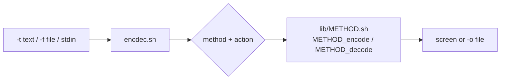

<!--
  AUTO-GENERATED FILE - do not edit README.md by hand.
  Edit README.template.md, then run:  make readme
-->

<div align="center">

# 🔐 encdec-shell

**A tiny, readable encoder & decoder for text, numbers and files - written in pure Bash.**


</div>

---

## 📑 Table of contents

- [Features](#-features)
- [Quick start](#-quick-start)
- [Supported methods](#-supported-methods)
- [Usage](#-usage)
- [How it works](#-how-it-works)
- [Project structure](#-project-structure)
- [Testing](#-testing)
- [Add your own method](#-add-your-own-method)
- [Contributing](#-contributing)
- [License](#-license)

## ✨ Features

- Encode and decode **text, strings, numbers and whole files** (binary files too)
- Input from `-t` text, `-f` file or **stdin**; output to screen or `-o` file
- 4 built-in methods, auto-detected from `lib/`
- No dependencies beyond standard Unix tools
- Small, commented code that is easy to read and extend

## 🚀 Quick start

```bash
git clone <your-repo-url> encdec-shell && cd encdec-shell
chmod +x encdec.sh

./encdec.sh encode -m base64 -t "Hello World"
./encdec.sh decode -m base64 -t "SGVsbG8gV29ybGQ="
```

## 🧩 Supported methods

Detected automatically from the `lib/` folder. The example column is generated by running the tool on `Hi`.

| Method | Description | Example (`Hi`) |
|--------|-------------|----------------|
| `base64` | encodes bytes as letters, digits, + and / | `SGk=` |
| `binary` | each byte becomes 8 bits, e.g. A = 01000001 | `01001000 01101001` |
| `hex` | each byte becomes 2 hex digits, e.g. Hi = 4869 | `4869` |
| `rot13` | shifts each letter by 13 (encode and decode are the same) | `Uv` |

## 📖 Usage

```text
Usage: ./encdec.sh <encode|decode> [options]

Options:
  -m METHOD   base64 (default) | hex | binary | rot13
  -t TEXT     text, string or number to process
  -f FILE     read input from a file
  -o FILE     write output to a file (default: print to screen)
  -h          show this help

If neither -t nor -f is given, input is read from stdin.

Examples:
  ./encdec.sh encode -m base64 -t "Hello World"
  ./encdec.sh decode -m base64 -t "SGVsbG8gV29ybGQ="
  ./encdec.sh encode -m hex    -t 12345
  ./encdec.sh decode -m hex    -f sample.enc -o out.txt
  echo "secret" | ./encdec.sh encode -m binary
```

**Files**

```bash
./encdec.sh encode -m base64 -f examples/sample.txt -o sample.enc
./encdec.sh decode -m base64 -f sample.enc -o sample.out
```

## ⚙️ How it works



Each method is two small functions, `<method>_encode` and `<method>_decode`, that **read stdin and write stdout**. `encdec.sh` builds the function name (for example `hex` + `encode` = `hex_encode`) and pipes your input into it.

## 🗂️ Project structure

```text
encdec-shell/
├── LICENSE
├── Makefile
├── README.md
├── README.template.md
├── VERSION
├── encdec.sh
├── examples/
│   ├── demo.sh
│   ├── sample.txt
├── lib/
│   ├── base64.sh
│   ├── binary.sh
│   ├── common.sh
│   ├── hex.sh
│   ├── rot13.sh
├── scripts/
│   ├── generate_readme.sh
├── tests/
│   ├── run_tests.sh
```

## 🧪 Testing

```bash
make test
```

<details>
<summary>Latest run: <b>24 passed, 0 failed</b> (2026-11-18)</summary>

```text
PASS  base64 encode
PASS  base64 decode
PASS  hex encode
PASS  binary encode
PASS  rot13 encode
PASS  base64 round-trip: Hello World
PASS  base64 round-trip: 1234567890
PASS  base64 round-trip: sp@cial !#$ chars
PASS  hex round-trip: Hello World
PASS  hex round-trip: 1234567890
PASS  hex round-trip: sp@cial !#$ chars
PASS  binary round-trip: Hello World
PASS  binary round-trip: 1234567890
PASS  binary round-trip: sp@cial !#$ chars
PASS  rot13 round-trip: Hello World
PASS  rot13 round-trip: 1234567890
PASS  rot13 round-trip: sp@cial !#$ chars
PASS  base64 file round-trip: text.bin
PASS  base64 file round-trip: random.bin
PASS  hex file round-trip: text.bin
PASS  hex file round-trip: random.bin
PASS  binary file round-trip: text.bin
PASS  binary file round-trip: random.bin
PASS  invalid hex is rejected

Passed: 24   Failed: 0
```

</details>

## ➕ Add your own method

<details>
<summary>Show steps</summary>

1. Create `lib/mymethod.sh`.
2. Add a first-line comment like `# MyMethod: what it does` (used in the methods table).
3. Define `mymethod_encode()` and `mymethod_decode()`, both reading stdin and writing stdout.
4. Run `make test` and `make readme`.

It is loaded automatically, no other changes needed.

</details>

## 🤝 Contributing

1. Fork the repo and create a branch
2. Make your change and add a test in `tests/run_tests.sh`
3. Run `make test` and `make readme`
4. Open a pull request

## 📄 License

Released under the [MIT License](LICENSE).

<sub>Version 1.0.0 · README generated on 2026-11-18</sub>
